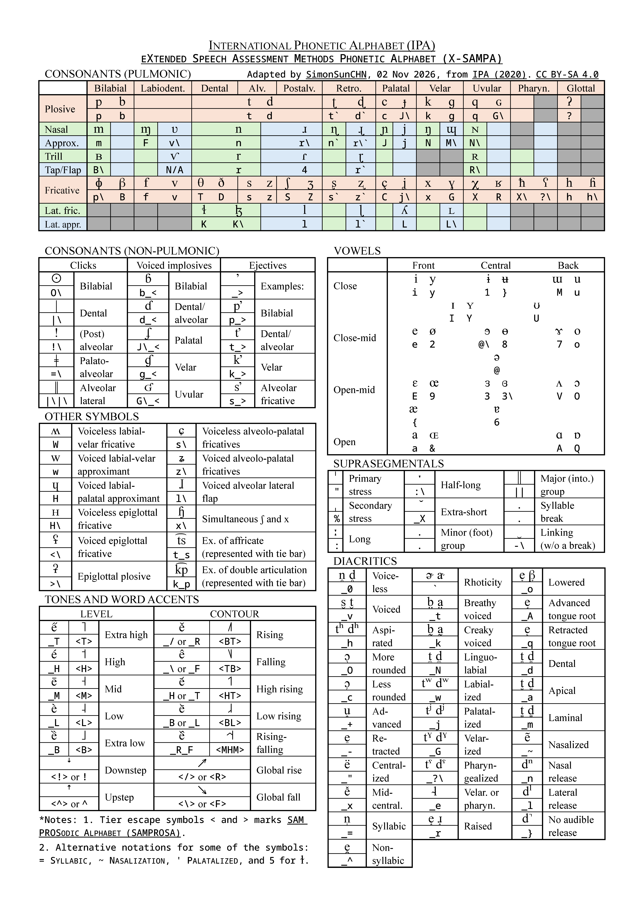

# 写在前面

语言学学习中，常常用到国际音标（International Phonetic Alphabet，IPA）。在 Android 手机上，可以用 Gboard 简单地输入 IPA。然而在 PC 上，除了使用网页版的 IPA 键盘（如 [Lexilogos 提供的在线 IPA 键盘](https://www.lexilogos.com/keyboard/ipa.htm)），个人比较常用 [RIME | 中州韻輸入法引擎](https://rime.im/) 配合 X-SAMPA 输入法输入。

为了方便对照输入，手搓了一张 IPA - X-SAMPA 对照表。

# 关于 X-SAMPA 与 SAMPROSA

> 拓展音标字母评估法（英语：Extended Speech Assessment Methods Phonetic Alphabet (X-SAMPA)）是 SAMPA 的一种变体，最先于 1995 年由伦敦大学的语言学教授约翰·克里斯托弗·韦尔斯（John C. Wells）提出。X-SAMPA 是为了统一各种 SAMPA 字母表而产生的，并且扩展至包含所有国际音标符号，能够把所有音标转写成七位元的 ASCII 码。（Wikipedia）

SAMPROSA（SAM Prosodic Alphabet）则是 SAMPA 的一个包含了韵律转写（Prosodic Transcription）所用符号的拓展。SAMPROSA 由 SAM Prosody Working Group 的 Dafydd Gibbon、Daniel J. Hirst、William J. Barry 提出。

:::important[注意]
“中州韻輸入法引擎” 的 X-SAMPA 输入 **不支持 SAMPROSA 符号**。
:::

# 对照表与说明

说明：
1. IPA 符号在上，X-SAMPA 符号在下。
2. 肺部气流音［Consonants (Pulmonic)］部分：为节省空间，鼻音（Nasal）与近音（Approx.）、颤音（Trill）与闪音（Tap/Flap）、边擦音（Lat. fric.）与边近音（Lat. appr.）合并到一行；绿色表示前者，蓝色表示后者。

# 软件与字体

软件：Word。

字体：Times New Roman、Doulos SIL、Noto Sans Mono Medium。

# 参考资料

::link{url="https://zh.wikipedia.org/wiki/X-SAMPA" title="X-SAMPA" description="维基百科，自由的百科全书"}
